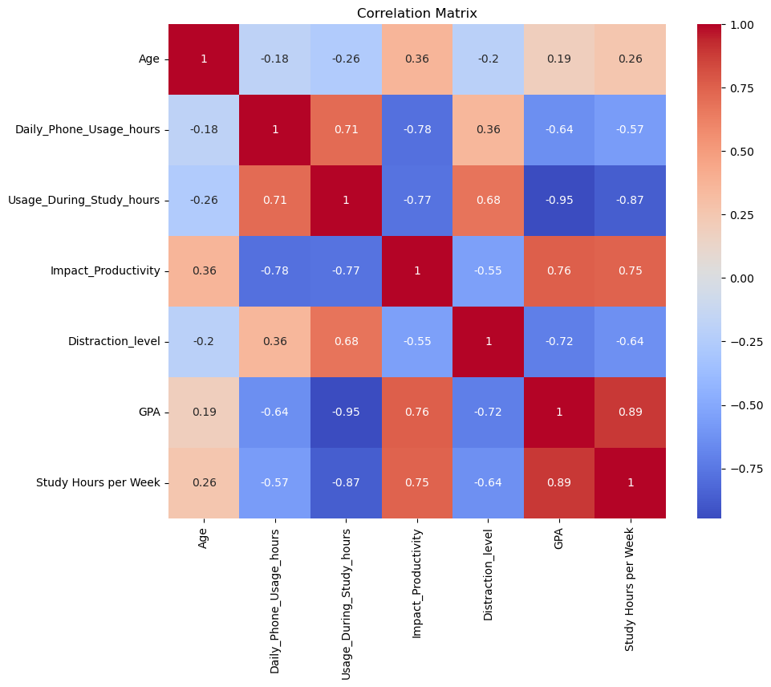

<div align="center">

# Smartphone Use, Study Habits, and GPA: A Machine Learning Study

**Analysis notebook and survey data for *Smartphone Use, Study Habits, and Academic Outcomes: Machine Learning Approaches to GPA Prediction* (CRC Press, 2026).**

[](https://doi.org/10.1201/9781042012725-15)
[](#publication)
[](https://scikit-learn.org/)

</div>

## Publication

**Smartphone Use, Study Habits, and Academic Outcomes: Machine Learning Approaches to GPA Prediction**
Zurinahni Zainol, Bakary Gibba, Altagi Abdallah Bakheit Abdelgadir, Almonzer Abdallah, Md Serajun Nabi, Basheer Riskhan
In *Smart, Inclusive, and Sustainable Digital Societies*, CRC Press, 2026, pp. 162–174. [doi:10.1201/9781042012725-15](https://doi.org/10.1201/9781042012725-15)

## Research Question

How are smartphone use and study habits associated with university students' GPA, and how well can simple machine-learning models predict GPA from them?

## Data

[`dilema.csv`](dilema.csv) holds anonymous survey responses from **89 students at Albukhary International University**. It contains no names or student IDs.

| Field | Description |
| --- | --- |
| `Age` | Student age |
| `Daily_Phone_Usage_hours` | Total phone use per day (hours) |
| `Usage_During_Study_hours` | Phone use during study time (hours) |
| `Impact_Productivity` | Self-rated impact of phone use on productivity (1–5) |
| `Distraction_level` | Self-rated distraction level (1–5) |
| `Most_App_Used` | Most-used app (descriptive only, not a model feature) |
| `Study_hours_per_week` | Study hours per week |
| `GPA` | Self-reported GPA (target) |

## Key Finding

Phone use **during study time** has the strongest relationship with GPA (r = −0.95), stronger than total daily phone use (r = −0.64). Weekly study hours are strongly positively correlated with GPA (r = 0.89).



## Models And Results

Six numeric features predict GPA. The data uses an 80/20 train/test split (`random_state=42`, 18 test responses).

| Model | MSE | R² |
| --- | ---: | ---: |
| Linear Regression | 0.0084 | 0.969 |
| **Random Forest** | **0.0053** | **0.980** |
| Support Vector Regression | 0.0161 | 0.940 |
| Gradient Boosting | 0.0060 | 0.978 |

### Notes on evaluation

- With 89 responses and 18 test cases, these scores come from a very small sample and a single split. Cross-validation would give more stable estimates.
- All variables are self-reported, and the survey covers one university, so the findings show association, not causation, and may not generalise.

## Repository Contents

| File | Purpose |
| --- | --- |
| [`gpa-prediction.ipynb`](gpa-prediction.ipynb) | Data cleaning, exploratory analysis, model training and comparison |
| [`dilema.csv`](dilema.csv) | Anonymous survey data |
| [`figures/`](figures/) | Figures exported from the notebook |
| [`CITATION.cff`](CITATION.cff) | Citation metadata for the chapter |

## Reproducing

```bash
pip install pandas numpy scikit-learn matplotlib seaborn jupyter
jupyter notebook gpa-prediction.ipynb
```

The notebook reads `dilema.csv` from the repository root.

## Citation

```bibtex
@incollection{zainol2026smartphone,
  author = {Zurinahni Zainol and Bakary Gibba and Altagi Abdallah Bakheit Abdelgadir and Almonzer Abdallah and Md Serajun Nabi and Basheer Riskhan},
  title = {Smartphone Use, Study Habits, and Academic Outcomes: Machine Learning Approaches to GPA Prediction},
  booktitle = {Smart, Inclusive, and Sustainable Digital Societies},
  publisher = {CRC Press},
  pages = {162--174},
  year = {2026},
  doi = {10.1201/9781042012725-15}
}
```

---

<div align="center">

**Part of [Bakary Gibba's AI engineering portfolio](https://github.com/BakaryGibba/bakary-gibba-ai-engineering-portfolio)**

[Portfolio website](https://bakary-gibba.vercel.app/) · [LinkedIn](https://www.linkedin.com/in/bakary-gibba-6409bb248/) · [Google Scholar](https://scholar.google.com/citations?user=bp0G4sgAAAAJ&hl=en)

</div>
